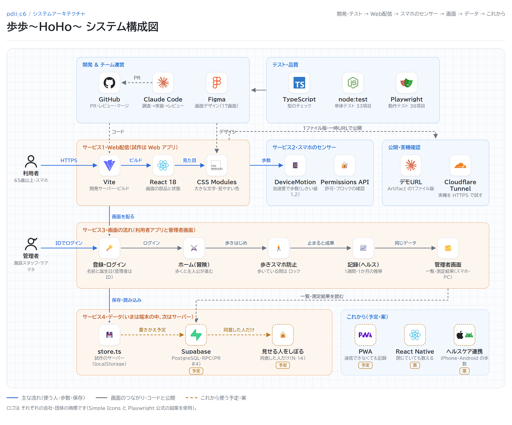

# 歩歩〜HoHo〜

歩くと画面の中の冒険が進み、歩数が経験値になって主人公が育つ、高齢者向けの RPG 型アプリです。
利用者が楽しく歩けることと、てまりフィットネスのスタッフやケアマネージャーが 自宅での活動量をデータで確かめられることを、1つのしくみで両立させます（チーム CCCA405-6・プロジェクトデザインⅡ）。



## できること（MVP の試作）

- **はじめての設定とログイン**：1画面に1項目で、名前・誕生日・呼び名・身長・体重・目標歩数を登録。次からは 名前と誕生日でログイン
- **歩くと進む冒険**：歩数が経験値になり、敵をたおしてポイント、レベルアップ（2D のドット絵）
- **歩数を数える**：スマホの体の動き（加速度センサー）で、アプリを開いている間だけ数える（iPhone・Android の実機で確認）
- **歩きスマホ防止**：歩いている間は 画面を操作できない。止まると 歩いた分の成果が出る
- **記録（ヘルス）**：歩数・距離・消費カロリーと、1週間・1か月の推移のグラフ
- **わたし**：目標歩数・文字の大きさ・記録を見せる相手（いつでも やめられる）
- **管理者画面**：施設スタッフ・ケアマネージャーが、同意した利用者の一覧と測定結果を見る（スマホ版・PC版）

## 使っている技術

| 分野 | 技術 | 使い方 |
| --- | --- | --- |
| 画面 | React 18・TypeScript | 利用者アプリと管理者画面を 1つの Web アプリで作る |
| ビルド | Vite | 開発サーバーと 本番用のビルド。デモ用の 1ファイル版も作る |
| 見た目 | CSS Modules・デザイントークン（`tokens.css`） | 大きな文字・はっきりした色・押しやすいボタン（N-01〜N-03） |
| 文字 | Google Fonts（BIZ UDPGothic・DotGothic16） | 読みやすい UD フォントと、ゲームのドット文字 |
| 歩数 | ブラウザの DeviceMotion・Permissions API | 加速度から歩数を数える（しきい値 1.2）。センサーの許可とブロックを調べる |
| データ（試作） | `store.ts`（ブラウザの localStorage） | 試作のサーバー。本実装では サーバーの API に置きかえる |
| テスト | TypeScript（tsc）・node:test・Playwright | 型のチェック、単体テスト 33項目、全ボタンの動作テスト 38項目 |
| デザイン | Figma | 全17画面のデザイン（`UIidea/`） |
| 開発 | GitHub・Claude Code | プルリクエストとレビュー。調査→計画→実装→テスト→レビューの役割を分けて進める（`CLAUDE.md`） |
| 実機の確認 | Cloudflare Tunnel | 一時的な HTTPS の URL で、iPhone・Android の実機で試す |

## これから使う予定

| 技術 | ねらい |
| --- | --- |
| Supabase（PostgreSQL・RPC） | 利用者と管理者が 別々の端末でも 同じデータを見られるようにする。管理者のログインをサーバーで確かめ、同意した人のデータだけを見せる（M-06・M-15・N-13・N-14） |
| PWA（Service Worker・IndexedDB） | ホーム画面に追加でき、通信できないときも記録して、つながったら送る（N-19） |
| HTTPS の公開先 | いつでも開ける場所に置く（N-12） |
| React Native（Expo）・ヘルスケア／ヘルスコネクト | スマホのアプリにするときの案。アプリを閉じている間も歩数を数える（N-08） |

試作は Web アプリで作り、アプリを閉じている間の計測（バックグラウンド計測）は作りません（11/6 決定）。くわしくは [要件定義書](docs/RDD.md) を見てください。

## フォルダ

| フォルダ | 中身 |
| --- | --- |
| `docs/` | 要件定義書（`RDD.md`）・活動まとめ・構成図の画像 |
| `UIidea/`・`PD.zip` | Figma の画面デザイン（画像） |
| `user-app/` | 利用者アプリと管理者画面の試作。動かし方は [`user-app/README.md`](user-app/README.md) |
| `.claude/agents/` | 開発の役割（researcher・test-runner・debugger） |

## 動かし方

```bash
cd user-app
npm install
npm run dev
```

ブラウザで <http://localhost:5173> を開きます。パソコンでは 左に確認用パネル、右に スマホの枠が出ます。テストは `npm test`（単体）と `npm run e2e`（動作。開発サーバーを起動したまま）で流します。
